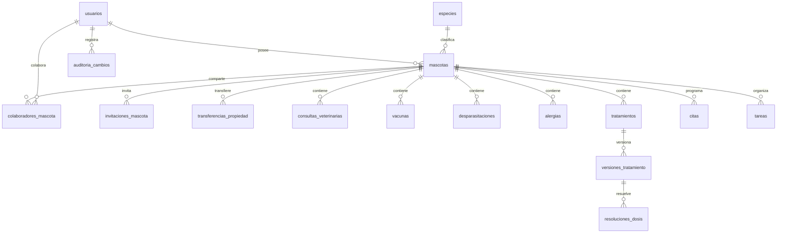

# 04 · Diseño propuesto de la base de datos

> **Motor:** PostgreSQL · **Nombre propuesto de la base de datos:** `gestion_mascotas` · **Idioma de tablas y columnas:** castellano · **Estado:** diseño lógico inicial derivado del plan general aceptado; el detalle de tablas, columnas y restricciones se revisará antes de generar SQL.  
> **Criterio de nombres:** `snake_case` y nombres descriptivos en castellano. También las tablas técnicas propias de la aplicación usarán castellano. Las convenciones internas obligatorias de Laravel se adaptarán mediante configuración y migraciones cuando proceda.

## 1. Principios del modelo

1. **Una mascota tiene un único propietario actual**.
2. **Colaboraciones independientes del rol global** del usuario.
3. Registros sanitarios tipados: consultas, vacunas, desparasitaciones y alergias.
4. **Papelera:** eliminación lógica de mascota con fecha de eliminación y recuperación durante 30 días.
5. **Auditoría:** conservar autor y modificaciones importantes, incluyendo motivo y valores anteriores.
6. **Historial conservado:** autoría original inmutable aunque cambie el propietario o se revoque a un colaborador.
7. **No duplicar calendario:** eventos agregados desde las entidades de origen.
8. Restricciones e índices en PostgreSQL; Laravel no sustituye la integridad en base de datos.

## 2. Convenciones técnicas

- Clave primaria en tablas de negocio: `id` (entero grande autoincremental; **propuesta**).
- Referencias: `usuario_id`, `mascota_id`, `tratamiento_id`, etc.
- Fechas sin hora: `fecha_*` (`date`). Instantes: `*_en` (`timestamptz`, UTC).
- Eliminación lógica: `eliminado_en` (`timestamptz`, nulo cuando activo).
- Campos de auditoría base: `creado_en`, `actualizado_en`, `creado_por_id`, cuando corresponda.
- Identificadores lógicos únicos y restricciones dentro del ámbito correcto (p. ej. alergias por mascota).
- Estados controlados por validación y, donde proceda, restricciones `CHECK`.
- Las horas programadas siguen la zona horaria definida para cada mascota o usuario; ver sección 9.

## 3. Catálogo de tablas

| Tabla (castellano) | Propósito | Prioridad |
|---|---|---|
| `usuarios` | Cuentas, datos de acceso y verificación | MVP |
| `especies` | Catálogo de especies | MVP |
| `mascotas` | Ficha general y propiedad actual | MVP |
| `colaboradores_mascota` | Lectores/editores activos | MVP |
| `invitaciones_mascota` | Invitaciones por enlace y correo | MVP |
| `transferencias_propiedad` | Solicitudes y resultado de cambio de propietario | MVP |
| `consultas_veterinarias` | Visitas sanitarias realizadas | MVP |
| `vacunas` | Administraciones de vacunas y próximas dosis | MVP |
| `desparasitaciones` | Aplicaciones realizadas y próximas fechas | MVP |
| `alergias` | Alergias sin estado activa/resuelta | MVP |
| `tratamientos` | Identidad general y estado de tratamiento | MVP |
| `versiones_tratamiento` | Instrucciones/frecuencia efectivas por periodo | Propuesta |
| `resoluciones_dosis` | Administración u omisión de dosis programada | Propuesta |
| `citas` | Citas futuras/realizadas/canceladas | Propuesta |
| `tareas` | Tareas asignables y compartidas | Propuesta |
| `auditoria_cambios` | Trazabilidad transversal | MVP (forma exacta propuesta) |

**Infraestructura de autenticación:** Laravel puede requerir tablas de sesiones, recuperación de contraseña o tokens según configuración. Si se almacenan en PostgreSQL, tendrán nombres castellanos configurados y documentados (p. ej. `sesiones`, `tokens_recuperacion`). No se dejarán nombres de negocio en inglés por inercia del framework.

## 4. Tablas y campos

### 4.1. `usuarios`

| Columna | Tipo orientativo | Regla |
|---|---|---|
| `id` | `bigint` | PK |
| `nombre` | `varchar(100)` | Obligatorio |
| `correo` | `varchar(254)` | Obligatorio, único normalizado |
| `contrasena` | `varchar(255)` | Hash, nunca texto plano |
| `correo_verificado_en` | `timestamptz` | Nulo hasta verificar |
| `creado_en`, `actualizado_en` | `timestamptz` | Automáticos |

### 4.2. `especies`

| Columna | Tipo | Regla |
|---|---|---|
| `id` | `bigint` | PK |
| `nombre` | `varchar(80)` | Único normalizado |
| `habilitada` | `boolean` | Permite ocultar opciones sin borrar relaciones |

La opción «Otra» se implementa con un valor de catálogo identificable más el texto `otra_especie` en la mascota; evitamos que cada variación del texto cree automáticamente una especie común.

### 4.3. `mascotas`

| Columna | Tipo orientativo | Regla |
|---|---|---|
| `id` | `bigint` | PK |
| `propietario_id` | `bigint` | FK a `usuarios`, obligatorio |
| `creador_id` | `bigint` | FK a `usuarios`, autoría inicial |
| `especie_id` | `bigint` | FK a `especies` |
| `otra_especie` | `varchar(80)` | Solo si especie = «Otra» |
| `nombre` | `varchar(60)` | Obligatorio |
| `raza` | `varchar(100)` | Opcional |
| `sexo` | `varchar(20)` | Opcional o «desconocido» |
| `precision_nacimiento` | `varchar(20)` | `exacta`, `mes_anio`, `anio`, `desconocida` |
| `anio_nacimiento`, `mes_nacimiento`, `dia_nacimiento` | `smallint` | Nulos según precisión |
| `peso_actual_kg` | `numeric(10,3)` | > 0 o nulo |
| `esterilizacion` | `varchar(20)` | `si`, `no`, `desconocido` |
| `microchip` | `varchar(30)` | Opcional, **no único** |
| `color_caracteristicas` | `varchar(150)` | Opcional |
| `observaciones` | `varchar(1000)` | Opcional |
| `foto_ruta` | `varchar(500)` | Ubicación privada del archivo |
| `creado_en`, `actualizado_en`, `eliminado_en` | `timestamptz` | Gestión y papelera |

**Nacimiento:** se comprueba consistencia: `exacta` requiere día/mes/año; `mes_anio` requiere mes/año sin día; `anio` requiere solo año; `desconocida` no guarda componentes. No se admiten fechas futuras.

### 4.4. `colaboradores_mascota`

| Columna | Tipo | Regla |
|---|---|---|
| `id`, `mascota_id`, `usuario_id` | `bigint` | PK y FK |
| `permiso` | `varchar(20)` | `lector` / `editor` |
| `concedido_en`, `revocado_en` | `timestamptz` | Acceso activo cuando `revocado_en IS NULL` |
| `concedido_por_id`, `revocado_por_id` | `bigint` | Auditoría de permisos |

Un índice único parcial por `(mascota_id, usuario_id)` donde `revocado_en IS NULL` evita colaboraciones activas duplicadas. El propietario **no necesita una fila de colaboración** por ser propietario.

### 4.5. `invitaciones_mascota`

`id`, `mascota_id`, `correo_destinatario`, `permiso`, `token_hash`, `estado` (`pendiente`, `aceptada`, `rechazada`, `cancelada`, `caducada`), `invitado_por_id`, `aceptado_por_id`, `creado_en`, `caduca_en`, `respondido_en`.

Guardar **hash** de token; nunca token utilizable en claro. El correo de la sesión autenticada debe coincidir con el destinatario, y se recomienda requerir correo verificado.

### 4.6. `transferencias_propiedad`

`id`, `mascota_id`, `propietario_origen_id`, `propietario_destino_id`, `estado` (`pendiente`, `aceptada`, `rechazada`, `cancelada`), `solicitada_en`, `resuelta_en`.

Aceptar transferencia en una única transacción que actualice `mascotas.propietario_id`, transforme antiguo propietario a editor y resuelva la solicitud. Solo una pendiente por mascota.

### 4.7. Registros veterinarios

**`consultas_veterinarias`**: `id`, `mascota_id`, `fecha_consulta`, `motivo`, `clinica_veterinario`, `diagnostico`, `recomendaciones`, `observaciones`, `creado_por_id`, `actualizado_por_id`, `eliminado_por_id`, `creado_en`, `actualizado_en`, `eliminado_en`.

**`vacunas`**: `id`, `mascota_id`, `nombre`, `fecha_administracion`, `proxima_dosis_fecha`, `clinica_veterinario`, `numero_lote`, `observaciones`, `vacuna_anterior_id` (FK a `vacunas`, opcional), `prevision_atendida_en` (opcional), autoría y marcas de tiempo/eliminación.

**`desparasitaciones`**: mismo patrón: `producto`, `fecha_aplicacion`, `tipo` (`interna`, `externa`, `ambas`), `proxima_aplicacion_fecha`, `desparasitacion_anterior_id`, `prevision_atendida_en`, `observaciones`, autoría y tiempos.

**`alergias`**: `id`, `mascota_id`, `alergeno`, `alergeno_normalizado`, `tipo`, `sintomas`, `gravedad`, `fecha_deteccion`, `observaciones`, autoría y tiempos.

- Restricción: `UNIQUE (mascota_id, alergeno_normalizado)` **solo entre registros no eliminados**; índice único parcial.
- Normalización definida de manera estable (espacios y mayúsculas/minúsculas; política de acentos a decidir y probar).
- Si se da de baja lógicamente una alergia, reintroducirla será posible conservando rastro histórico.
- Integridad: las referencias «anterior» de vacunas/desparasitaciones deben pertenecer a la **misma mascota**, garantizada por transacción/validaciones y, si se desea, clave compuesta.

### 4.8. `tratamientos`

`id`, `mascota_id`, `nombre`, `tipo` (`medicamento`, `cuidado`), `estado` (`en_curso`, `finalizado`, `cancelado`), `creado_por_id`, `motivo_cancelacion`, `creado_en`, `actualizado_en`, `finalizado_en`, `cancelado_en`, `eliminado_en`.

### 4.9. `versiones_tratamiento` **[Detalle técnico por revisar]**

`id`, `tratamiento_id`, `numero_version`, `indicaciones`, `cantidad`, `unidad`, `fecha_inicio`, `fecha_fin`, `tipo_frecuencia` (`diaria`, `cada_horas`, `dias_semana`, `unica`), `intervalo_horas`, `dias_semana` (formato estructurado), `horarios` (formato estructurado), `zona_horaria`, `vigor_desde_en`, `vigor_hasta_en`, `creado_por_id`, `motivo_cambio`, `creado_en`.

Cada versión es inmutable después de entrar en vigor. El tratamiento agrupa sus versiones; una administración se vincula a la versión que definía la dosis.

### 4.10. `resoluciones_dosis` **[Detalle técnico por revisar]**

`id`, `tratamiento_id`, `version_tratamiento_id`, `dosis_clave`, `fecha_hora_programada`, `estado` (`administrada`, `omitida`), `fecha_hora_real`, `cantidad_real`, `unidad_real`, `registrado_por_id`, `realizado_por_usuario_id` (opcional), `realizado_por_nombre` (opcional), `observaciones`, `motivo_correccion`, `creado_en`, `actualizado_en`.

`dosis_clave` identifica de forma determinista la ocurrencia de una pauta (por ejemplo identificador de versión + instante programado). **Índice único por ocurrencia** para impedir dos resoluciones concurrentes de la misma dosis; correcciones mediante auditoría y actualización autorizada, no segundo registro contradictorio.

No hace falta almacenar en una tabla cada dosis futura: se calculan para una ventana y se combinan con sus resoluciones persistidas.

### 4.11. `citas` y `tareas` **[Detalle técnico por revisar]**

**`citas`**: `id`, `mascota_id`, `titulo`, `descripcion`, `fecha_hora_inicio`, `lugar`, `estado`, `consulta_veterinaria_id` (opcional), `creado_por_id`, `actualizado_en`, `eliminado_en`.

**`tareas`**: `id`, `mascota_id`, `titulo`, `descripcion`, `fecha_hora_programada`, `responsable_id` (opcional), `estado`, `creado_por_id`, `completado_por_id`, `completado_en`, `cancelado_en`, `eliminado_en`.

### 4.12. `auditoria_cambios`

`id`, `entidad_tipo`, `entidad_id`, `accion`, `usuario_id`, `motivo`, `valores_anteriores` (`jsonb`), `valores_nuevos` (`jsonb`), `ocurrido_en`, `metadatos` (`jsonb` opcional).

Excluir contraseñas, tokens, credenciales y otros secretos del registro de auditoría. Acceso a auditorías con permisos limitados. Para registros sanitarios, motivo obligatorio en la corrección conforme a lo aprobado.

## 5. ERD conceptual en Mermaid

Este ERD omite claves de autoría secundarias para mantenerlo legible; las tablas del apartado 4 son la referencia para campos.

## 6. Reglas de borrado e integridad

- **Mascota en papelera:** `eliminado_en` deja de ser nulo. No borrar enseguida consultas, tratamientos o colaboraciones: deben restaurarse si vuelve la mascota.
- **A los 30 días:** procedimiento controlado y registrable de eliminación de archivos y registros asociados, con política de conservación de evidencia de seguridad y protección de datos a validar.
- **Registros veterinarios:** soft delete con autor de eliminación; no pérdida silenciosa de auditoría.
- **Tratamientos con ejecuciones:** se cierran, no se eliminan como si no hubieran existido.
- **Usuario revocado:** conservar autoría mediante FK y desactivar acceso. No convertir autoría en nombre libre.
- **Eliminar cuenta:** resolver previamente mascotas de las que sea propietario y definir anonimización/retención de autorías de acuerdo con la política de privacidad.

## 7. Índices y restricciones prioritarios

1. `usuarios(correo)` único case-insensitive normalizado.
2. `mascotas(propietario_id, eliminado_en)`.
3. `colaboradores_mascota(mascota_id, usuario_id)` único parcial para activos.
4. `invitaciones_mascota(token_hash)` único y `caduca_en` indexado.
5. `alergias(mascota_id, alergeno_normalizado)` único parcial donde activo.
6. `vacunas(mascota_id, fecha_administracion)`; `desparasitaciones(mascota_id, fecha_aplicacion)`.
7. `tratamientos(mascota_id, estado)`; `resoluciones_dosis(dosis_clave)` único.
8. `tareas(mascota_id, fecha_hora_programada)` y `citas(mascota_id, fecha_hora_inicio)`.
9. Auditoría por `(entidad_tipo, entidad_id, ocurrido_en)`.

## 8. Migraciones, datos de ejemplo y responsable

- El integrante responsable de **layout y BBDD** diseñará tablas, relaciones e índices y preparará migraciones/datos iniciales **en coordinación** con el integrante de backend.
- Migraciones versionadas en Git; prohibido editar directamente el esquema de producción.
- Datos semilla de demostración ficticios; nunca datos personales reales en el repositorio.
- Revisar conjuntamente cada migración antes de fusionarla a `development`.

## 9. Zona horaria y calendario

- Almacenar **instantes** en UTC y mostrarlos según zona horaria establecida; configurar inicialmente una zona del usuario/mascota consistente.
- Las **fechas sin hora** (consulta o vacunación realizada) son `date`, no deben cambiar de día por conversión horaria.
- «Todos los días a las 09:00» representa hora **local programada**, con tratamiento de horario de verano. Para dosis «cada X horas», la periodicidad es de horas transcurridas.
- No generar dosis futuras indefinidamente: consulta de una ventana temporal + resoluciones guardadas.

## 10. Cuestiones por confirmar antes de generar SQL

1. Versión inicial exacta de PostgreSQL y Laravel; convención final de zonas horarias.
2. Pauta versionada y estados/omisiones de dosis.
3. Estructura exacta de las frecuencias y alcance de cambios retroactivos.
4. Definición jurídica/operativa de eliminación definitiva de auditoría y datos de personas.
5. Configuración exacta de las tablas auxiliares de Laravel en castellano.

> **No generar el SQL definitivo hasta aprobar estas cuestiones y revisar el ERD con el equipo.**

[Índice](README.md) · [Requisitos](02_REQUISITOS_FUNCIONALES.md) · [Arquitectura](05_ARQUITECTURA.md)
