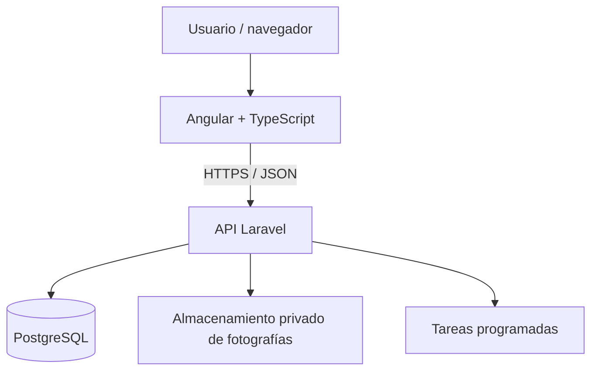

# 05 · Arquitectura técnica y funcionamiento

> **Estado:** arquitectura general aceptada en el plan maestro; quedan por comprobar versiones compatibles y detalles de implementación.

## 1. Objetivo arquitectónico

Construir una aplicación **web responsive**, con un frontend Angular que consume una API REST Laravel y una base de datos PostgreSQL. Utilizar un **monolito modular**, evitando microservicios y capas no justificadas para un TFG.



## 2. Tecnologías

| Área | Elección propuesta | Motivo |
|---|---|---|
| UI | Angular + TypeScript | Componentes, formularios y rutas tipadas |
| Estilo | Tailwind CSS | Utilidades responsive |
| Componentes | PrimeNG | Tablas, controles, diálogos, calendario |
| API | Laravel/PHP | Validación, autorización, relaciones |
| Base de datos | PostgreSQL | Integridad y transacciones |
| Autenticación | Laravel Sanctum para SPA | Sesiones/cookies con defensa CSRF |
| Tests frontend | Herramientas integradas de Angular | Servicios y componentes |
| Tests backend | PHPUnit o Pest | Permisos y lógica |
| Tests E2E | Playwright | Flujos reales de navegador |
| CI | GitHub Actions | Construcción y tests |

No fijamos números de versión sin comprobar compatibilidad en el momento de iniciar el repositorio.

## 3. Estructura de carpetas: **solo los directorios en inglés**

Los nombres de carpetas se mantendrán en inglés para conservar convenciones de herramientas y el reconocimiento de iconos en Visual Studio Code. **Los nombres de funciones de negocio, clases propias, tablas, columnas, rutas funcionales y documentación se escribirán en castellano** (salvo archivos estándar exigidos por los frameworks).

```text
petcare/
├── frontend/
│   ├── src/
│   │   ├── app/
│   │   │   ├── core/                   # Autenticación, interceptores, configuración
│   │   │   ├── shared/                 # Componentes y utilidades reutilizables
│   │   │   ├── features/
│   │   │   │   ├── pets/                # Componentes de mascotas
│   │   │   │   ├── veterinary-history/  # Historial sanitario
│   │   │   │   ├── collaboration/       # Invitaciones y permisos
│   │   │   │   ├── treatments/          # Tratamientos
│   │   │   │   └── calendar/            # Agenda y tareas
│   │   │   └── layouts/                 # Distribución visual
│   │   └── assets/                      # Imágenes e iconos públicos de UI
│   └── tests/
├── backend/
│   ├── app/
│   │   ├── Models/                      # Mascota.php, Usuario.php...
│   │   ├── Http/
│   │   │   ├── Controllers/             # Controladores de API
│   │   │   └── Requests/                # Reglas de validación
│   │   ├── Policies/                    # Autorizaciones por mascota/registro
│   │   ├── Services/                    # Invitaciones, pautas, calendario...
│   │   └── Jobs/                        # Trabajo programado
│   ├── routes/                           # api.php y rutas del framework
│   ├── database/
│   │   ├── migrations/                 # Migraciones SQL desde Laravel
│   │   ├── seeders/                    # Datos de prueba
│   │   └── factories/                   # Factorías de prueba
│   └── tests/
│       ├── Feature/
│       └── Unit/
├── docs/                               # Documentos Markdown en castellano
├── infra/                              # Configuración de despliegue
└── .github/
    └── workflows/                     # Integración continua
```

*Nota:* Laravel y Angular incluyen rutas y archivos obligatorios con nombres propios del framework (por ejemplo `app`, `routes`, `api.php`, `composer.json`). Esos nombres técnicos se mantienen para no romper las herramientas; los identificadores diseñados por el equipo siguen en castellano.

## 4. Responsabilidades por capa

### Angular

- Presentar componentes, formularios y navegación.
- Validar entradas para experiencia de uso, **sin sustituir validaciones del servidor**.
- Obtener y enviar datos a la API mediante servicios.
- Administrar estado de interfaz, carga, errores y sesión.
- Mostrar botones según permisos recibidos; no tomar decisiones de seguridad definitivas.

### API Laravel

- Identificar usuario y permisos efectivos de cada mascota.
- Validar peticiones y aplicar políticas.
- Ejecutar transacciones y restricciones de integridad.
- Crear/reglar registros veterinarios, pautas y resoluciones de dosis.
- Resolver acceso a fotografías y generación de enlaces.
- Construir una respuesta agregada para el calendario.
- Exponer errores consistentes y auditables.

### PostgreSQL

- Guardar datos, relaciones, índices, unicidades y claves foráneas.
- Asegurar operaciones atómicas y evitar duplicados bajo concurrencia.
- Almacenar auditoría con acceso restringido.

## 5. Flujo de una operación

Ejemplo: un editor confirma una dosis.

1. Angular envía petición autenticada a `/api/tratamientos/{id}/administraciones`.
2. El controlador valida la estructura de la petición.
3. Una política comprueba que el usuario mantiene permiso en esa mascota.
4. Un servicio comprueba vigencia de pauta, ocurrencia programada y fecha real.
5. PostgreSQL aplica transacción y restricción única de la dosis.
6. Se guarda la resolución y auditoría.
7. La API devuelve recurso resultante; Angular actualiza agenda.
8. Si otro cuidador ya confirmó la dosis, devolver `409 Conflict` con mensaje claro.

## 6. Autenticación y permisos

- Para SPA con Angular en un origen compatible, proponer Sanctum con cookie de sesión y protección CSRF.
- Activar controles de origen/CORS/cookies de forma compatible con dominios reales.
- Toda ruta que exponga datos de mascota aplica política de acceso.
- Para edición de registros, validar tanto acceso a mascota como **autoría o propiedad**.
- Invitaciones: token opaco aleatorio, hash en base de datos, correo destino verificado, caducidad y consumo único.
- Fotografías: servir bajo ruta autorizada o mediante URL firmada de duración corta; evitar enlaces públicos permanentes.

## 7. Tratamientos y calendario

- La pauta define cómo obtener ocurrencias programadas.
- No precrear infinitas dosis de tratamientos indefinidos.
- Al consultar el calendario, calcular ocurrencias de la ventana solicitada y cruzarlas con resoluciones guardadas.
- Las vacunas/desparasitaciones previstas son fechas del propio registro sanitario, no una segunda copia editable.
- Citas y tareas son recursos independientes con estados propios.
- Cambios de pauta afectan ocurrencias futuras; histórico conserva versión anterior.

## 8. Fechas, horarios y concurrencia

- Definir al iniciar el proyecto una política coherente de zona horaria para usuarios/mascotas.
- Para fechas de nacimiento incompletas almacenar año/mes/día conocidos y precisión, no un `date` ficticio.
- Bloquear doble confirmación de dosis **en PostgreSQL**, no con un `if` únicamente en Angular.
- Transferencias e invitaciones se resuelven transaccionalmente.

## 9. Gestión de errores

| Código | Interpretación |
|---|---|
| 400 | Solicitud mal formada |
| 401 | Sesión ausente o caducada |
| 403 | Acción no autorizada |
| 404 | Recurso inexistente o no visible |
| 409 | Conflicto: dosis ya registrada o estado cambiado |
| 422 | Error de validación de campos |
| 500 | Fallo inesperado, sin exponer secretos |

## 10. Criterios de calidad

- Clases y métodos centrados en una responsabilidad.
- Evitar lógica duplicada de permisos.
- Tests de servicio/política en operaciones sensibles.
- No secretos en `environment` de Angular, documentación ni repositorio.
- CI en `development` y `main` antes de despliegue.

[Índice](README.md) · [Directorio](07_ESTRUCTURA_PROYECTO.md) · [API](06_API_REST.md) · [Base de datos](04_BASE_DE_DATOS.md)
