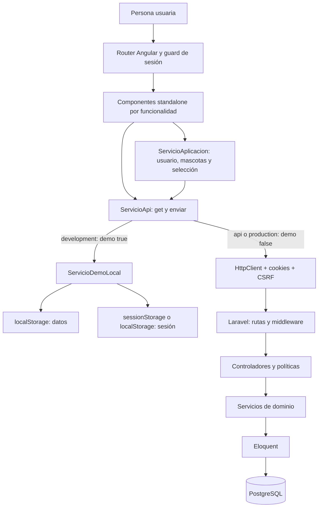

# Arquitectura

PetCare organiza los cuidados compartidos de mascotas: fichas, historial veterinario, tratamientos, dosis, citas, tareas y colaboración. El monorepo contiene una SPA Angular 21 y una API Laravel 12 preparada para PostgreSQL. Hay un modo local para demostrar los flujos sin instalar un servidor.

## Componentes y flujo



## Selección de modo

| Comando en frontend | Modo | Persistencia | Necesita Laravel |
| --- | --- | --- | --- |
| `npm start` | development, demo local | Navegador y origen actuales | No |
| `npm run start:api` | api, desarrollo con API | PostgreSQL | Sí |
| `npm run build` | production, API real | PostgreSQL al desplegar | Sí |
| `npm run build -- --configuration development` | demo compilada | Navegador | No |

`environment.ts` define `demo: false`; `environment.development.ts` define `demo: true`. `angular.json` sustituye el archivo únicamente en desarrollo demo. Un fallo de red nunca activa la demo de forma automática. El backend no reconoce el usuario público `prueba` por el hecho de existir en el frontend.

## Frontend

- `app.routes.ts` define rutas diferidas dentro de `EstructuraComponent` y protege las páginas privadas mediante `sesionGuard`.
- `ServicioAplicacion` inicializa una vez el estado, consulta la sesión, carga especies y mascotas y mantiene la selección con signals/computed.
- `PaginaApi` coordina ocupado/error/aviso, evita envíos repetidos y limpia el estado cuando una operación devuelve 401.
- `ServicioApi` presenta una interfaz común; en modo real envía cookies y prepara `/sanctum/csrf-cookie`, con un único reintento si recibe 419.
- Formularios compartidos reciben descripciones de campos; los módulos separan las definiciones de ficha, historial y pauta en `campos-*.ts`.
- `ServicioIdioma` conserva castellano/euskera y actualiza idioma del documento, fechas y título. Los datos introducidos por la persona se conservan en su idioma original.

## Sesión

```mermaid
sequenceDiagram
  participant U as Persona
  participant R as Router/guard
  participant A as ServicioAplicacion
  participant S as Adaptador seleccionado
  U->>R: Abrir /mascotas
  R->>A: inicializar()
  A->>S: estado y yo
  alt Sin sesión válida
    R-->>U: /acceso?volver=/mascotas
    U->>S: inicio-sesion
    S-->>A: Usuario
    A->>S: mascotas y especies
    R-->>U: Ruta solicitada
  else Sesión existente
    R-->>U: Página privada
  end
  U->>A: Cerrar sesión
  A->>S: cierre-sesion
  A-->>R: Limpiar usuario, mascotas y selección; /acceso
```

La sesión local es una comodidad de demostración y sus datos son modificables por quien controla el navegador. La seguridad real reside en Laravel/Sanctum y las políticas del servidor. El indicador de recordar sesión solo se ofrece en demo; al cerrarla se elimina también el recuerdo persistente.

## Backend y persistencia

Las rutas públicas de diagnóstico están separadas de las operaciones que exigen BD. El middleware de BD devuelve 503 cuando `PETCARE_BD_HABILITADA=false`. Las rutas privadas incorporan autenticación Sanctum y comprobación de versión de sesión. Las autorizaciones se verifican por mascota y por operación.

Eloquent utiliza tablas y marcas temporales castellanas. El diseño es **database first**: el SQL define claves, restricciones, índices y funciones, y los modelos se adaptan. El arranque no crea ni modifica la BD. Consultar [diccionario](BASE_DE_DATOS.md) y [mapa backend](MAPA_BACKEND.md).

## Reglas transversales

- Propietario: edición y gestión compartida. Ayudante: consulta. Una mascota admite varios propietarios con permisos equivalentes.
- La eliminación y salida de un propietario deben respetar la existencia de otros propietarios. La confirmación de contraseña se verifica en la capa que ejecuta la operación.
- Los tratamientos mantienen versiones; las dosis se calculan a partir de la pauta, y sus resoluciones se guardan separadamente.
- Diferenciar fechas sin hora de instantes UTC. Las vistas convierten los instantes para mostrarlos y mantienen la fecha civil de vacunas y nacimientos.
- Los códigos son de un uso y caducan. La demo reproduce el flujo solo entre cuentas almacenadas en el mismo navegador.
- Las fotos de producción se sirven mediante la API autorizada. Las fotos de demo permanecen en el almacenamiento local.

## Límites

No hay sincronización remota, correo real ni garantía de conservación en el modo local. Cambiar entre `localhost` y `127.0.0.1`, de puerto o de navegador cambia el origen de almacenamiento. La exportación local permite descargar datos, pero no es una copia de seguridad de PostgreSQL. El modo de producción necesita configuración y validación de servidor, BD y HTTPS. No se ejecutó SQL de instalación como parte de este cambio.
