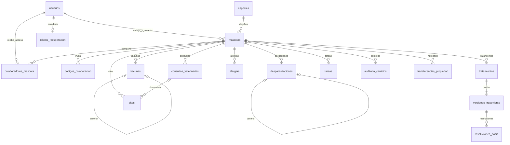

# Diccionario de la base de datos

Fuente de verdad: [01_crear_esquema.sql](../database/sql/01_crear_esquema.sql). Este diccionario cubre sus **17 tablas y todas sus columnas**; revisión del 17 de noviembre de 2026. Se ha contrastado con el código, sin crear la base ni ejecutar el SQL. Los ejemplos son ilustrativos y ficticios, no un conjunto de inserciones ni recomendaciones de cuidados.

## Instalación y actualización

| Archivo | Uso |
| --- | --- |
| [00_crear_base_de_datos.sql](../database/sql/00_crear_base_de_datos.sql) | Crea gestion_mascotas con UTF-8; conectar a postgres, fuera de transacción; omitir si ya existe. |
| [01_crear_esquema.sql](../database/sql/01_crear_esquema.sql) | Inicializa una base vacía dentro de una transacción. No volver a ejecutar sobre una instalación existente. |
| [02_catalogo_especies.sql](../database/sql/02_catalogo_especies.sql) | Inserta solo ocho especies; ON CONFLICT por código no duplica las existentes. No crea cuentas ni mascotas. |
| [crear_todo.psql](../database/sql/crear_todo.psql) | Lanzador psql: 00, conexión a gestion_mascotas, 01 y 02; detiene ante error. No usar --single-transaction. |
| [03_roles_compartidos.sql](../database/sql/03_roles_compartidos.sql) | Actualización manual solo de instalaciones anteriores; el esquema 01 actual ya incorpora los cambios. |

El parche 03 bloquea mascotas, colaboradores y códigos; convierte editor/visor en ayudante, sustituye checks de rol, cancela códigos antiguos pendientes, fija caducidad por defecto de 20 minutos, incorpora mascota_id/índice en auditoría si faltan, cancela transferencias pendientes y vacía recuperacion_hash. Revisar y respaldar antes de aplicarlo a una instalación anterior. No restaura mascotas históricas en papelera ni constituye un mecanismo general de migraciones.

El proyecto es **database first**: no usar artisan migrate, migrate:fresh, db:wipe ni db:seed. Las sesiones y caché son de archivos; Sanctum SPA no necesita tabla de tokens personales. El modo local de prueba usa almacenamiento del navegador y no este esquema.

## Convenciones

- PK: clave primaria; FK: clave foránea. Los id usan bigint GENERATED ALWAYS AS IDENTITY; los ejemplos de ID nunca se deben forzar en un INSERT habitual.
- NULL se permite únicamente cuando la columna no tiene NOT NULL/PK. «Sin default» significa que no hay valor explícito de base de datos; al omitir una columna nullable se obtiene NULL.
- timestamptz representa un instante, no conserva una etiqueta IANA por fila; zona_horaria mantiene la zona para presentación/cálculo. date representa un día local. numeric(10,3) tiene siete dígitos enteros y tres decimales.
- Las FK no especifican borrado en cascada. ServicioPropiedad borra dependencias en orden en una transacción cuando sale el último propietario.
- Las restricciones SQL que se reproducen debajo de cada tabla son literales; la API añade validación adicional. Defaults SQL y requisitos HTTP pueden diferir: para crear mascota la API exige precision_nacimiento, esterilizacion y zona_horaria.
- Los campos de hash muestran marcadores explicativos, nunca secretos reales. Las marcas temporales son ejemplos independientes de la fecha actual.

## Relaciones principales



El diagrama resume relaciones del dominio. Autoría, creador, ejecutor, revocador y demás referencias a usuarios se detallan en las columnas. SQL permite una cabecera de tratamiento sin versiones; la aplicación crea la primera en la misma transacción. Las relaciones sanitarias y versión/resolución usan FK compuestas para impedir cruces entre mascotas/tratamientos.

## índice de tablas

- [usuarios](#usuarios) — Cuentas reales del backend. El usuario de prueba del navegador no se inserta aquí.
- [especies](#especies) — Catálogo estable de especies; 02 inserta perro, gato, conejo, ave, roedor, reptil, pez y otra.
- [mascotas](#mascotas) — Ficha y propietario de anclaje. Las copropiedades se representan en colaboradores_mascota.
- [colaboradores_mascota](#colaboradores_mascota) — Historial de accesos compartidos. Una fila sin revocado_en es acceso activo.
- [codigos_colaboracion](#codigos_colaboracion) — Invitaciones de un uso con vigencia de 20 minutos; solo se almacena el hash.
- [transferencias_propiedad](#transferencias_propiedad) — Tabla heredada reservada. No hay rutas activas de transferencia exclusiva.
- [consultas_veterinarias](#consultas_veterinarias) — Actuaciones veterinarias realizadas, con autoría y borrado lógico.
- [vacunas](#vacunas) — Administraciones realizadas y previsiones opcionales; cada anterior admite una única siguiente.
- [desparasitaciones](#desparasitaciones) — Aplicaciones realizadas, clasificación interna/externa/ambas y siguientes aplicaciones.
- [alergias](#alergias) — Alergias registradas; impide duplicados activos por mascota y alérgeno normalizado.
- [tratamientos](#tratamientos) — Cabecera estable del medicamento o cuidado; las pautas están versionadas aparte.
- [versiones_tratamiento](#versiones_tratamiento) — Versiones inmutables en su contenido histórico; los cambios cierran vigencia y abren una nueva.
- [resoluciones_dosis](#resoluciones_dosis) — Ocurrencias administradas u omitidas. Las dosis aún pendientes se calculan, no se insertan.
- [citas](#citas) — Eventos de agenda que pueden enlazarse a una consulta veterinaria de la misma mascota.
- [tareas](#tareas) — Tareas con responsable opcional y trazabilidad de completado/cancelación.
- [auditoria_cambios](#auditoria_cambios) — Snapshots y motivos escritos explícitamente por servicios; no es auditoría automática universal.
- [tokens_recuperacion](#tokens_recuperacion) — Tabla heredada sin endpoints activos. No coincide con el repositorio estándar password_reset_tokens.

## usuarios

Cuentas reales del backend. El usuario de prueba del navegador no se inserta aquí.

| Columna | Tipo SQL | NULL | Default / generación | Descripción | Ejemplo |
| --- | --- | --- | --- | --- | --- |
| `id` | `bigint` | No | IDENTITY | Identificador interno generado por PostgreSQL. | `42` |
| `nombre` | `varchar(100)` | No | Sin default | Nombre visible de la cuenta. | `Persona de ejemplo` |
| `correo` | `varchar(254)` | No | Sin default | Correo normalizado a minúsculas, sin espacios exteriores. | `persona@example.test` |
| `contrasena` | `varchar(255)` | No | Sin default | Hash de contraseña producido por el cast hashed de Usuario; nunca texto plano. | `[hash bcrypt; no es una contraseña]` |
| `correo_verificado_en` | `timestamptz` | Sí | Sin default | Instante de verificación reservado; sin flujo público activo. | `NULL` |
| `token_recuerdo` | `varchar(100)` | Sí | Sin default | Token de recuerdo de Laravel; el inicio actual no activa remember. | `NULL` |
| `recuperacion_hash` | `char(64)` | Sí | Sin default | Campo heredado de recuperación; no usado por rutas actuales. | `NULL` |
| `version_sesion` | `integer` | No | 1 | Versión que invalida sesiones antiguas al cambiar la contraseña/eliminar cuenta. | `1` |
| `eliminado_en` | `timestamptz` | Sí | Sin default | Marca de borrado lógico o baja; NULL indica registro no marcado. | `NULL` |
| `zona_horaria` | `varchar(100)` | No | 'Europe/Madrid' | Zona IANA para interpretar fechas y horarios locales. | `Europe/Madrid` |
| `creado_en` | `timestamptz` | No | CURRENT_TIMESTAMP | Instante de creación. | `2026-10-01T08:00:00Z` |
| `actualizado_en` | `timestamptz` | No | CURRENT_TIMESTAMP | Instante de última actualización; trigger en las tablas indicadas al final. | `2026-10-01T08:00:00Z` |

Restricciones e índices del SQL (las FK simples figuran en las columnas):

```sql
id bigint GENERATED ALWAYS AS IDENTITY PRIMARY KEY
nombre varchar(100) NOT NULL CHECK (length(btrim(nombre)) > 0)
correo varchar(254) NOT NULL CHECK (correo = lower(btrim(correo)))
version_sesion integer NOT NULL DEFAULT 1 CHECK (version_sesion > 0)
CONSTRAINT usuarios_correo_unico UNIQUE (correo)
```

## especies

Catálogo estable de especies; 02 inserta perro, gato, conejo, ave, roedor, reptil, pez y otra.

| Columna | Tipo SQL | NULL | Default / generación | Descripción | Ejemplo |
| --- | --- | --- | --- | --- | --- |
| `id` | `bigint` | No | IDENTITY | Identificador interno generado por PostgreSQL. | `42` |
| `codigo` | `varchar(40)` | No | Sin default | Identificador estable del catálogo. | `perro` |
| `nombre` | `varchar(80)` | No | Sin default | Nombre de especie en castellano. | `Perro` |
| `habilitada` | `boolean` | No | true | Permite seleccionar la especie en altas/ediciones. | `true` |

Restricciones e índices del SQL (las FK simples figuran en las columnas):

```sql
id bigint GENERATED ALWAYS AS IDENTITY PRIMARY KEY
codigo varchar(40) NOT NULL UNIQUE
nombre varchar(80) NOT NULL CHECK (length(btrim(nombre)) > 0)
CREATE UNIQUE INDEX especies_nombre_unico ON especies (lower(btrim(nombre)));
```

## mascotas

Ficha y propietario de anclaje. Las copropiedades se representan en colaboradores_mascota.

| Columna | Tipo SQL | NULL | Default / generación | Descripción | Ejemplo |
| --- | --- | --- | --- | --- | --- |
| `id` | `bigint` | No | IDENTITY | Identificador interno generado por PostgreSQL. | `42` |
| `propietario_id` | `bigint` | No | Sin default | FK usuarios.id: propietario de anclaje interno, con iguales permisos que copropietarios. | `7` |
| `creador_id` | `bigint` | No | Sin default | FK usuarios.id: usuario que creó la mascota. | `7` |
| `especie_id` | `bigint` | No | Sin default | FK especies.id: especie elegida del catálogo. | `1` |
| `otra_especie` | `varchar(80)` | Sí | Sin default | Descripción solo si el código de especie es otra; obligatoria en ese caso. | `NULL` |
| `nombre` | `varchar(60)` | No | Sin default | Nombre visible del registro. | `Luna` |
| `raza` | `varchar(100)` | Sí | Sin default | Raza declarada; no hay catálogo separado. | `Mestiza` |
| `sexo` | `varchar(20)` | Sí | Sin default | Valor macho, hembra o desconocido; también admite NULL. | `hembra` |
| `precision_nacimiento` | `varchar(20)` | No | 'desconocida' | Nivel conocido: exacta, mes_anio, anio o desconocida. | `exacta` |
| `anio_nacimiento` | `smallint` | Sí | Sin default | Año conocido; obligatorio salvo precisión desconocida. | `2021` |
| `mes_nacimiento` | `smallint` | Sí | Sin default | Mes 1–12; solo para precisión exacta o mes_anio. | `5` |
| `dia_nacimiento` | `smallint` | Sí | Sin default | Día 1–31; solo para precisión exacta; se comprueba fecha real. | `12` |
| `peso_actual_kg` | `numeric(10,3)` | Sí | Sin default | Peso actual positivo en kilogramos, hasta tres decimales. | `12.350` |
| `esterilizacion` | `varchar(20)` | No | 'desconocido' | Estado si, no o desconocido. | `si` |
| `microchip` | `varchar(30)` | Sí | Sin default | Identificación de microchip; no tiene UNIQUE en el SQL actual. | `981000000000042` |
| `color_caracteristicas` | `varchar(150)` | Sí | Sin default | Descripción breve de rasgos físicos. | `Blanca con manchas marrones` |
| `observaciones` | `varchar(1000)` | Sí | Sin default | Notas libres del registro. | `Registro ficticio de ejemplo` |
| `foto_ruta` | `varchar(500)` | Sí | Sin default | Ruta privada en disco local; el modelo no la expone en JSON. | `pets/42/ejemplo.webp` |
| `zona_horaria` | `varchar(100)` | No | 'Europe/Madrid' | Zona IANA para interpretar fechas y horarios locales. | `Europe/Madrid` |
| `creado_en` | `timestamptz` | No | CURRENT_TIMESTAMP | Instante de creación. | `2026-10-01T08:00:00Z` |
| `actualizado_en` | `timestamptz` | No | CURRENT_TIMESTAMP | Instante de última actualización; trigger en las tablas indicadas al final. | `2026-10-01T08:00:00Z` |
| `eliminado_en` | `timestamptz` | Sí | Sin default | Marca de borrado lógico o baja; NULL indica registro no marcado. | `NULL` |

Restricciones e índices del SQL (las FK simples figuran en las columnas):

```sql
id bigint GENERATED ALWAYS AS IDENTITY PRIMARY KEY
nombre varchar(60) NOT NULL CHECK (length(btrim(nombre)) BETWEEN 1 AND 60)
sexo varchar(20) CHECK (sexo IN ('macho', 'hembra', 'desconocido'))
precision_nacimiento varchar(20) NOT NULL DEFAULT 'desconocida'
        CHECK (precision_nacimiento IN ('exacta', 'mes_anio', 'anio', 'desconocida'))
anio_nacimiento smallint CHECK (anio_nacimiento BETWEEN 1 AND 9999)
mes_nacimiento smallint CHECK (mes_nacimiento BETWEEN 1 AND 12)
dia_nacimiento smallint CHECK (dia_nacimiento BETWEEN 1 AND 31)
peso_actual_kg numeric(10,3) CHECK (peso_actual_kg > 0)
esterilizacion varchar(20) NOT NULL DEFAULT 'desconocido' CHECK (esterilizacion IN ('si', 'no', 'desconocido'))
CONSTRAINT nacimiento_componentes CHECK (
        (precision_nacimiento = 'desconocida' AND anio_nacimiento IS NULL AND mes_nacimiento IS NULL AND dia_nacimiento IS NULL) OR
        (precision_nacimiento = 'anio' AND anio_nacimiento IS NOT NULL AND mes_nacimiento IS NULL AND dia_nacimiento IS NULL) OR
        (precision_nacimiento = 'mes_anio' AND anio_nacimiento IS NOT NULL AND mes_nacimiento IS NOT NULL AND dia_nacimiento IS NULL) OR
        (precision_nacimiento = 'exacta' AND anio_nacimiento IS NOT NULL AND mes_nacimiento IS NOT NULL AND dia_nacimiento IS NOT NULL)
    )
CREATE INDEX mascotas_propietario_papelera ON mascotas(propietario_id, eliminado_en);
```

## colaboradores_mascota

Historial de accesos compartidos. Una fila sin revocado_en es acceso activo.

| Columna | Tipo SQL | NULL | Default / generación | Descripción | Ejemplo |
| --- | --- | --- | --- | --- | --- |
| `id` | `bigint` | No | IDENTITY | Identificador interno generado por PostgreSQL. | `42` |
| `mascota_id` | `bigint` | No | Sin default | FK mascotas.id: mascota a la que pertenece el registro. | `42` |
| `usuario_id` | `bigint` | No | Sin default | FK usuarios.id: cuenta asociada a la operación o relación. | `8` |
| `permiso` | `varchar(20)` | No | Sin default | Rol propietario o ayudante; ayudante solo consulta. | `ayudante` |
| `concedido_en` | `timestamptz` | No | CURRENT_TIMESTAMP | Instante en el que comenzó el acceso compartido. | `2026-10-01T08:00:00Z` |
| `revocado_en` | `timestamptz` | Sí | Sin default | Fin del acceso; NULL indica colaboración activa. | `NULL` |
| `concedido_por_id` | `bigint` | No | Sin default | FK usuarios.id: propietario que concedió acceso. | `7` |
| `revocado_por_id` | `bigint` | Sí | Sin default | FK usuarios.id: usuario que retiró el acceso o salió. | `NULL` |

Restricciones e índices del SQL (las FK simples figuran en las columnas):

```sql
id bigint GENERATED ALWAYS AS IDENTITY PRIMARY KEY
permiso varchar(20) NOT NULL CHECK (permiso IN ('propietario', 'ayudante'))
CHECK (revocado_en IS NULL OR revocado_en >= concedido_en)
CREATE UNIQUE INDEX colaboradores_activos_unicos ON colaboradores_mascota(mascota_id, usuario_id) WHERE revocado_en IS NULL;
CREATE INDEX colaboradores_usuario ON colaboradores_mascota(usuario_id) WHERE revocado_en IS NULL;
```

## codigos_colaboracion

Invitaciones de un uso con vigencia de 20 minutos; solo se almacena el hash.

| Columna | Tipo SQL | NULL | Default / generación | Descripción | Ejemplo |
| --- | --- | --- | --- | --- | --- |
| `id` | `bigint` | No | IDENTITY | Identificador interno generado por PostgreSQL. | `42` |
| `mascota_id` | `bigint` | No | Sin default | FK mascotas.id: mascota a la que pertenece el registro. | `42` |
| `creado_por_id` | `bigint` | No | Sin default | FK usuarios.id: autor de la creación. | `7` |
| `permiso` | `varchar(20)` | No | Sin default | Rol propietario o ayudante; ayudante solo consulta. | `ayudante` |
| `codigo_hash` | `char(64)` | No | Sin default | SHA-256 del código normalizado; único, no se guarda el código original. | `[64 caracteres hexadecimales ficticios]` |
| `creado_en` | `timestamptz` | No | CURRENT_TIMESTAMP | Instante de creación. | `2026-10-01T08:00:00Z` |
| `caduca_en` | `timestamptz` | No | (CURRENT_TIMESTAMP + interval '20 minutes') | Límite exclusivo de aceptación del código, 20 minutos desde creación por defecto. | `2026-10-01T08:20:00Z` |
| `usado_en` | `timestamptz` | Sí | Sin default | Instante de consumo único de la invitación. | `NULL` |
| `usado_por_id` | `bigint` | Sí | Sin default | FK usuarios.id: receptor que consumió el código. | `NULL` |
| `cancelado_en` | `timestamptz` | Sí | Sin default | Instante de cancelación. | `NULL` |

Restricciones e índices del SQL (las FK simples figuran en las columnas):

```sql
id bigint GENERATED ALWAYS AS IDENTITY PRIMARY KEY
permiso varchar(20) NOT NULL CHECK (permiso IN ('propietario', 'ayudante'))
codigo_hash char(64) NOT NULL UNIQUE
CHECK (caduca_en > creado_en)
CHECK ((usado_en IS NULL AND usado_por_id IS NULL) OR (usado_en IS NOT NULL AND usado_por_id IS NOT NULL))
CHECK (usado_en IS NULL OR cancelado_en IS NULL)
CREATE INDEX codigos_mascota ON codigos_colaboracion(mascota_id, creado_en);
CREATE INDEX codigos_pendientes ON codigos_colaboracion(caduca_en) WHERE usado_en IS NULL AND cancelado_en IS NULL;
```

## transferencias_propiedad

Tabla heredada reservada. No hay rutas activas de transferencia exclusiva.

| Columna | Tipo SQL | NULL | Default / generación | Descripción | Ejemplo |
| --- | --- | --- | --- | --- | --- |
| `id` | `bigint` | No | IDENTITY | Identificador interno generado por PostgreSQL. | `42` |
| `mascota_id` | `bigint` | No | Sin default | FK mascotas.id: mascota a la que pertenece el registro. | `42` |
| `propietario_origen_id` | `bigint` | No | Sin default | FK usuarios.id: propietario que proponía la transferencia heredada. | `7` |
| `propietario_destino_id` | `bigint` | No | Sin default | FK usuarios.id: destinatario distinto del origen. | `8` |
| `estado` | `varchar(20)` | No | 'pendiente' | Estado del flujo; consultar valores permitidos en las restricciones de la tabla. | `pendiente` |
| `solicitada_en` | `timestamptz` | No | CURRENT_TIMESTAMP | Instante de solicitud de transferencia heredada. | `2026-10-01T08:00:00Z` |
| `resuelta_en` | `timestamptz` | Sí | Sin default | Instante de resolución; requerido si deja de estar pendiente. | `NULL` |

Restricciones e índices del SQL (las FK simples figuran en las columnas):

```sql
id bigint GENERATED ALWAYS AS IDENTITY PRIMARY KEY
estado varchar(20) NOT NULL DEFAULT 'pendiente' CHECK (estado IN ('pendiente','aceptada','rechazada','cancelada'))
CHECK (propietario_origen_id <> propietario_destino_id)
CHECK ((estado = 'pendiente' AND resuelta_en IS NULL) OR (estado <> 'pendiente' AND resuelta_en IS NOT NULL))
CREATE UNIQUE INDEX transferencia_pendiente_unica ON transferencias_propiedad(mascota_id) WHERE estado = 'pendiente';
```

## consultas_veterinarias

Actuaciones veterinarias realizadas, con autoría y borrado lógico.

| Columna | Tipo SQL | NULL | Default / generación | Descripción | Ejemplo |
| --- | --- | --- | --- | --- | --- |
| `id` | `bigint` | No | IDENTITY | Identificador interno generado por PostgreSQL. | `42` |
| `mascota_id` | `bigint` | No | Sin default | FK mascotas.id: mascota a la que pertenece el registro. | `42` |
| `fecha_consulta` | `date` | No | Sin default | Día local en que se realizó la consulta; no futuro. | `2026-10-01` |
| `motivo` | `varchar(500)` | No | Sin default | Motivo o justificación descriptiva. | `Revisión anual` |
| `clinica_veterinario` | `varchar(200)` | Sí | Sin default | Nombre libre de clúnica o profesional. | `Clúnica de ejemplo` |
| `diagnostico` | `text` | Sí | Sin default | Texto registrado del diagnóstico; la app no lo calcula. | `Revisión sin incidencias` |
| `recomendaciones` | `text` | Sí | Sin default | Instrucciones registradas durante la consulta. | `Seguimiento según profesional` |
| `observaciones` | `text` | Sí | Sin default | Notas libres del registro. | `Registro ficticio de ejemplo` |
| `creado_por_id` | `bigint` | No | Sin default | FK usuarios.id: autor de la creación. | `7` |
| `actualizado_por_id` | `bigint` | Sí | Sin default | FK usuarios.id: autor de la última corrección explícita. | `NULL` |
| `eliminado_por_id` | `bigint` | Sí | Sin default | FK usuarios.id: autor del borrado lógico. | `NULL` |
| `creado_en` | `timestamptz` | No | CURRENT_TIMESTAMP | Instante de creación. | `2026-10-01T08:00:00Z` |
| `actualizado_en` | `timestamptz` | No | CURRENT_TIMESTAMP | Instante de última actualización; trigger en las tablas indicadas al final. | `2026-10-01T08:00:00Z` |
| `eliminado_en` | `timestamptz` | Sí | Sin default | Marca de borrado lógico o baja; NULL indica registro no marcado. | `NULL` |

Restricciones e índices del SQL (las FK simples figuran en las columnas):

```sql
id bigint GENERATED ALWAYS AS IDENTITY PRIMARY KEY
motivo varchar(500) NOT NULL CHECK (length(btrim(motivo)) > 0)
UNIQUE(id, mascota_id)
CREATE INDEX consultas_cronologia ON consultas_veterinarias(mascota_id, fecha_consulta);
```

## vacunas

Administraciones realizadas y previsiones opcionales; cada anterior admite una única siguiente.

| Columna | Tipo SQL | NULL | Default / generación | Descripción | Ejemplo |
| --- | --- | --- | --- | --- | --- |
| `id` | `bigint` | No | IDENTITY | Identificador interno generado por PostgreSQL. | `42` |
| `mascota_id` | `bigint` | No | Sin default | FK mascotas.id: mascota a la que pertenece el registro. | `42` |
| `nombre` | `varchar(150)` | No | Sin default | Nombre de la vacuna registrada. | `Vacuna de ejemplo` |
| `fecha_administracion` | `date` | No | Sin default | Día local de administración de la vacuna; no futuro. | `2026-10-01` |
| `proxima_dosis_fecha` | `date` | Sí | Sin default | Previsión opcional posterior a la administración. | `2027-10-01` |
| `clinica_veterinario` | `varchar(200)` | Sí | Sin default | Nombre libre de clúnica o profesional. | `Clúnica de ejemplo` |
| `numero_lote` | `varchar(100)` | Sí | Sin default | Lote del producto administrado. | `LOTE-DEMO-001` |
| `observaciones` | `text` | Sí | Sin default | Notas libres del registro. | `Registro ficticio de ejemplo` |
| `vacuna_anterior_id` | `bigint` | Sí | Sin default | Autorreferencia compuesta con mascota_id a vacuna anterior de la misma mascota. | `41` |
| `prevision_atendida_en` | `timestamptz` | Sí | Sin default | Marca de previsión atendida al crear la siguiente actuación. | `NULL` |
| `creado_por_id` | `bigint` | No | Sin default | FK usuarios.id: autor de la creación. | `7` |
| `actualizado_por_id` | `bigint` | Sí | Sin default | FK usuarios.id: autor de la última corrección explícita. | `NULL` |
| `eliminado_por_id` | `bigint` | Sí | Sin default | FK usuarios.id: autor del borrado lógico. | `NULL` |
| `creado_en` | `timestamptz` | No | CURRENT_TIMESTAMP | Instante de creación. | `2026-10-01T08:00:00Z` |
| `actualizado_en` | `timestamptz` | No | CURRENT_TIMESTAMP | Instante de última actualización; trigger en las tablas indicadas al final. | `2026-10-01T08:00:00Z` |
| `eliminado_en` | `timestamptz` | Sí | Sin default | Marca de borrado lógico o baja; NULL indica registro no marcado. | `NULL` |

Restricciones e índices del SQL (las FK simples figuran en las columnas):

```sql
id bigint GENERATED ALWAYS AS IDENTITY PRIMARY KEY
nombre varchar(150) NOT NULL CHECK (length(btrim(nombre)) > 0)
proxima_dosis_fecha date CHECK (proxima_dosis_fecha > fecha_administracion)
UNIQUE(id, mascota_id)
FOREIGN KEY (vacuna_anterior_id, mascota_id) REFERENCES vacunas(id, mascota_id)
CHECK (vacuna_anterior_id IS NULL OR vacuna_anterior_id <> id)
CHECK (prevision_atendida_en IS NULL OR proxima_dosis_fecha IS NOT NULL)
CREATE UNIQUE INDEX vacuna_siguiente_unica ON vacunas(vacuna_anterior_id) WHERE vacuna_anterior_id IS NOT NULL;
CREATE INDEX vacunas_cronologia ON vacunas(mascota_id, fecha_administracion);
```

## desparasitaciones

Aplicaciones realizadas, clasificación interna/externa/ambas y siguientes aplicaciones.

| Columna | Tipo SQL | NULL | Default / generación | Descripción | Ejemplo |
| --- | --- | --- | --- | --- | --- |
| `id` | `bigint` | No | IDENTITY | Identificador interno generado por PostgreSQL. | `42` |
| `mascota_id` | `bigint` | No | Sin default | FK mascotas.id: mascota a la que pertenece el registro. | `42` |
| `producto` | `varchar(150)` | No | Sin default | Nombre del producto registrado. | `Producto de ejemplo` |
| `fecha_aplicacion` | `date` | No | Sin default | Día local de la desparasitación; no futuro. | `2026-10-01` |
| `tipo` | `varchar(20)` | No | Sin default | Clasificación del registro; restricciones específicas por tabla. | `interna` |
| `proxima_aplicacion_fecha` | `date` | Sí | Sin default | Previsión posterior a la aplicación registrada. | `2026-12-01` |
| `desparasitacion_anterior_id` | `bigint` | Sí | Sin default | Autorreferencia compuesta con mascota_id a actuación anterior de la misma mascota. | `41` |
| `prevision_atendida_en` | `timestamptz` | Sí | Sin default | Marca de previsión atendida al crear la siguiente actuación. | `NULL` |
| `observaciones` | `text` | Sí | Sin default | Notas libres del registro. | `Registro ficticio de ejemplo` |
| `creado_por_id` | `bigint` | No | Sin default | FK usuarios.id: autor de la creación. | `7` |
| `actualizado_por_id` | `bigint` | Sí | Sin default | FK usuarios.id: autor de la última corrección explícita. | `NULL` |
| `eliminado_por_id` | `bigint` | Sí | Sin default | FK usuarios.id: autor del borrado lógico. | `NULL` |
| `creado_en` | `timestamptz` | No | CURRENT_TIMESTAMP | Instante de creación. | `2026-10-01T08:00:00Z` |
| `actualizado_en` | `timestamptz` | No | CURRENT_TIMESTAMP | Instante de última actualización; trigger en las tablas indicadas al final. | `2026-10-01T08:00:00Z` |
| `eliminado_en` | `timestamptz` | Sí | Sin default | Marca de borrado lógico o baja; NULL indica registro no marcado. | `NULL` |

Restricciones e índices del SQL (las FK simples figuran en las columnas):

```sql
id bigint GENERATED ALWAYS AS IDENTITY PRIMARY KEY
producto varchar(150) NOT NULL CHECK (length(btrim(producto)) > 0)
tipo varchar(20) NOT NULL CHECK (tipo IN ('interna','externa','ambas'))
proxima_aplicacion_fecha date CHECK (proxima_aplicacion_fecha > fecha_aplicacion)
UNIQUE(id, mascota_id)
FOREIGN KEY (desparasitacion_anterior_id, mascota_id) REFERENCES desparasitaciones(id, mascota_id)
CHECK (desparasitacion_anterior_id IS NULL OR desparasitacion_anterior_id <> id)
CHECK (prevision_atendida_en IS NULL OR proxima_aplicacion_fecha IS NOT NULL)
CREATE UNIQUE INDEX desparasitacion_siguiente_unica ON desparasitaciones(desparasitacion_anterior_id) WHERE desparasitacion_anterior_id IS NOT NULL;
CREATE INDEX desparasitaciones_cronologia ON desparasitaciones(mascota_id, fecha_aplicacion);
```

## alergias

Alergias registradas; impide duplicados activos por mascota y alérgeno normalizado.

| Columna | Tipo SQL | NULL | Default / generación | Descripción | Ejemplo |
| --- | --- | --- | --- | --- | --- |
| `id` | `bigint` | No | IDENTITY | Identificador interno generado por PostgreSQL. | `42` |
| `mascota_id` | `bigint` | No | Sin default | FK mascotas.id: mascota a la que pertenece el registro. | `42` |
| `alergeno` | `varchar(150)` | No | Sin default | Sustancia o elemento que origina la alergia declarada. | `Polen` |
| `alergeno_normalizado` | `text` | Sí | Expresión generada STORED | Columna generada: trim, minúsculas y espacios consecutivos agrupados; conserva acentos. | `polen` |
| `tipo` | `varchar(100)` | Sí | Sin default | Clasificación libre de la alergia. | `Ambiental` |
| `sintomas` | `text` | Sí | Sin default | Síntomas registrados. | `Picor` |
| `gravedad` | `varchar(50)` | Sí | Sin default | Texto de gravedad; API limita a leve, moderada o grave aunque SQL solo limita longitud. | `leve` |
| `fecha_deteccion` | `date` | Sí | Sin default | Día local de detección, si se conoce; no futuro. | `2026-09-20` |
| `observaciones` | `text` | Sí | Sin default | Notas libres del registro. | `Registro ficticio de ejemplo` |
| `creado_por_id` | `bigint` | No | Sin default | FK usuarios.id: autor de la creación. | `7` |
| `actualizado_por_id` | `bigint` | Sí | Sin default | FK usuarios.id: autor de la última corrección explícita. | `NULL` |
| `eliminado_por_id` | `bigint` | Sí | Sin default | FK usuarios.id: autor del borrado lógico. | `NULL` |
| `creado_en` | `timestamptz` | No | CURRENT_TIMESTAMP | Instante de creación. | `2026-10-01T08:00:00Z` |
| `actualizado_en` | `timestamptz` | No | CURRENT_TIMESTAMP | Instante de última actualización; trigger en las tablas indicadas al final. | `2026-10-01T08:00:00Z` |
| `eliminado_en` | `timestamptz` | Sí | Sin default | Marca de borrado lógico o baja; NULL indica registro no marcado. | `NULL` |

Restricciones e índices del SQL (las FK simples figuran en las columnas):

```sql
id bigint GENERATED ALWAYS AS IDENTITY PRIMARY KEY
alergeno varchar(150) NOT NULL CHECK (length(btrim(alergeno)) > 0)
alergeno_normalizado text GENERATED ALWAYS AS (lower(regexp_replace(btrim(alergeno), '\s+', ' ', 'g'))) STORED
CREATE UNIQUE INDEX alergia_activa_unica ON alergias(mascota_id, alergeno_normalizado) WHERE eliminado_en IS NULL;
```

## tratamientos

Cabecera estable del medicamento o cuidado; las pautas están versionadas aparte.

| Columna | Tipo SQL | NULL | Default / generación | Descripción | Ejemplo |
| --- | --- | --- | --- | --- | --- |
| `id` | `bigint` | No | IDENTITY | Identificador interno generado por PostgreSQL. | `42` |
| `mascota_id` | `bigint` | No | Sin default | FK mascotas.id: mascota a la que pertenece el registro. | `42` |
| `nombre` | `varchar(150)` | No | Sin default | Nombre visible del tratamiento o cuidado. | `Cepillado` |
| `tipo` | `varchar(20)` | No | Sin default | medicamento o cuidado. | `cuidado` |
| `estado` | `varchar(20)` | No | 'en_curso' | en_curso, finalizado o cancelado. | `en_curso` |
| `creado_por_id` | `bigint` | No | Sin default | FK usuarios.id: autor de la creación. | `7` |
| `motivo_cancelacion` | `text` | Sí | Sin default | Justificación de cierre; API lo escribe también al finalizar. | `NULL` |
| `creado_en` | `timestamptz` | No | CURRENT_TIMESTAMP | Instante de creación. | `2026-10-01T08:00:00Z` |
| `actualizado_en` | `timestamptz` | No | CURRENT_TIMESTAMP | Instante de última actualización; trigger en las tablas indicadas al final. | `2026-10-01T08:00:00Z` |
| `finalizado_en` | `timestamptz` | Sí | Sin default | Instante de cierre manual finalizado. | `NULL` |
| `cancelado_en` | `timestamptz` | Sí | Sin default | Instante de cancelación. | `NULL` |
| `eliminado_en` | `timestamptz` | Sí | Sin default | Marca de borrado lógico o baja; NULL indica registro no marcado. | `NULL` |

Restricciones e índices del SQL (las FK simples figuran en las columnas):

```sql
id bigint GENERATED ALWAYS AS IDENTITY PRIMARY KEY
nombre varchar(150) NOT NULL CHECK (length(btrim(nombre)) > 0)
tipo varchar(20) NOT NULL CHECK (tipo IN ('medicamento','cuidado'))
estado varchar(20) NOT NULL DEFAULT 'en_curso' CHECK (estado IN ('en_curso','finalizado','cancelado'))
CHECK (estado <> 'cancelado' OR (cancelado_en IS NOT NULL AND nullif(btrim(motivo_cancelacion), '') IS NOT NULL))
CHECK (estado <> 'finalizado' OR finalizado_en IS NOT NULL)
CREATE INDEX tratamientos_mascota_estado ON tratamientos(mascota_id, estado);
```

## versiones_tratamiento

Versiones inmutables en su contenido histórico; los cambios cierran vigencia y abren una nueva.

| Columna | Tipo SQL | NULL | Default / generación | Descripción | Ejemplo |
| --- | --- | --- | --- | --- | --- |
| `id` | `bigint` | No | IDENTITY | Identificador interno generado por PostgreSQL. | `42` |
| `tratamiento_id` | `bigint` | No | Sin default | FK tratamientos.id: tratamiento al que pertenece versión o resolución. | `42` |
| `numero_version` | `integer` | No | Sin default | Número positivo de versión, único por tratamiento. | `1` |
| `indicaciones` | `text` | No | Sin default | Instrucciones registradas de la pauta, no vacías. | `Cepillado diario` |
| `cantidad` | `numeric(10,3)` | Sí | Sin default | Cantidad positiva prevista; obligatoria para medicamentos. | `1.000` |
| `unidad` | `varchar(50)` | Sí | Sin default | Unidad necesaria cuando hay cantidad. | `sesión` |
| `prescriptor` | `varchar(200)` | Sí | Sin default | Nombre libre del profesional que indicó la pauta. | `Profesional de ejemplo` |
| `observaciones` | `text` | Sí | Sin default | Notas libres del registro. | `Registro ficticio de ejemplo` |
| `fecha_inicio` | `date` | No | Sin default | Primer día local de la pauta. | `2026-10-01` |
| `fecha_fin` | `date` | Sí | Sin default | último día local incluido; NULL para pauta abierta. | `NULL` |
| `tipo_frecuencia` | `varchar(20)` | No | Sin default | diaria, cada_horas, dias_semana o unica. | `diaria` |
| `intervalo_horas` | `integer` | Sí | Sin default | Horas transcurridas entre ocurrencias; solo cada_horas. | `NULL` |
| `dias_semana` | `jsonb` | Sí | Sin default | Array JSON de días ISO 1=lunes–7=domingo; solo dias_semana. | `NULL` |
| `horarios` | `jsonb` | Sí | Sin default | Array JSON de horas locales HH:mm distintas; NULL para cada_horas. | `["19:00"]` |
| `ancla_en` | `timestamptz` | Sí | Sin default | Instante UTC inicial de la secuencia cada_horas; NULL en otras frecuencias. | `NULL` |
| `zona_horaria` | `varchar(100)` | No | 'Europe/Madrid' | Zona IANA para interpretar fechas y horarios locales. | `Europe/Madrid` |
| `vigor_desde_en` | `timestamptz` | No | Sin default | Inicio inclusivo de vigencia de esta versión. | `2026-09-30T22:00:00Z` |
| `vigor_hasta_en` | `timestamptz` | Sí | Sin default | Fin exclusivo de vigencia; NULL para versión abierta. | `NULL` |
| `creado_por_id` | `bigint` | No | Sin default | FK usuarios.id: autor de la creación. | `7` |
| `motivo_cambio` | `text` | Sí | Sin default | Justificación al crear una versión posterior. | `NULL` |
| `creado_en` | `timestamptz` | No | CURRENT_TIMESTAMP | Instante de creación. | `2026-10-01T08:00:00Z` |

Restricciones e índices del SQL (las FK simples figuran en las columnas):

```sql
id bigint GENERATED ALWAYS AS IDENTITY PRIMARY KEY
numero_version integer NOT NULL CHECK (numero_version > 0)
indicaciones text NOT NULL CHECK (length(btrim(indicaciones)) > 0)
cantidad numeric(10,3) CHECK (cantidad > 0)
fecha_fin date CHECK (fecha_fin >= fecha_inicio)
tipo_frecuencia varchar(20) NOT NULL CHECK (tipo_frecuencia IN ('diaria','cada_horas','dias_semana','unica'))
intervalo_horas integer CHECK (intervalo_horas > 0)
vigor_hasta_en timestamptz CHECK (vigor_hasta_en >= vigor_desde_en)
UNIQUE(tratamiento_id, numero_version)
UNIQUE(id, tratamiento_id)
CHECK ((tipo_frecuencia = 'cada_horas' AND intervalo_horas IS NOT NULL) OR (tipo_frecuencia <> 'cada_horas' AND intervalo_horas IS NULL))
CHECK ((tipo_frecuencia = 'dias_semana' AND dias_semana IS NOT NULL AND jsonb_typeof(dias_semana) = 'array' AND jsonb_array_length(dias_semana) BETWEEN 1 AND 7 AND '[1,2,3,4,5,6,7]'::jsonb @> dias_semana) OR (tipo_frecuencia <> 'dias_semana' AND dias_semana IS NULL))
CHECK ((tipo_frecuencia IN ('diaria','dias_semana','unica') AND horarios IS NOT NULL AND horarios_validos(horarios)) OR (tipo_frecuencia = 'cada_horas' AND horarios IS NULL))
CHECK (tipo_frecuencia <> 'unica' OR (fecha_fin IS NOT NULL AND fecha_fin = fecha_inicio AND jsonb_array_length(horarios) = 1))
CHECK ((tipo_frecuencia = 'cada_horas' AND ancla_en IS NOT NULL) OR (tipo_frecuencia <> 'cada_horas' AND ancla_en IS NULL))
CHECK (cantidad IS NULL OR nullif(btrim(unidad), '') IS NOT NULL)
CREATE UNIQUE INDEX version_abierta_unica ON versiones_tratamiento(tratamiento_id) WHERE vigor_hasta_en IS NULL;
```

## resoluciones_dosis

Ocurrencias administradas u omitidas. Las dosis aún pendientes se calculan, no se insertan.

| Columna | Tipo SQL | NULL | Default / generación | Descripción | Ejemplo |
| --- | --- | --- | --- | --- | --- |
| `id` | `bigint` | No | IDENTITY | Identificador interno generado por PostgreSQL. | `42` |
| `tratamiento_id` | `bigint` | No | Sin default | FK tratamientos.id: tratamiento al que pertenece versión o resolución. | `42` |
| `version_tratamiento_id` | `bigint` | No | Sin default | FK compuesta con tratamiento_id a versiones_tratamiento; evita cruzar tratamientos. | `42` |
| `dosis_clave` | `varchar(160)` | No | Sin default | Clave única versión:instante UTC calculada en GeneradorDosis. | `42:2026-10-01T17:00:00Z` |
| `fecha_hora_programada` | `timestamptz` | No | Sin default | Instante previsto de una dosis o tarea. | `2026-10-01T17:00:00Z` |
| `estado` | `varchar(20)` | No | Sin default | administrada u omitida. | `administrada` |
| `fecha_hora_real` | `timestamptz` | Sí | Sin default | Instante no futuro de administración; requerido solo para administrada. | `2026-10-01T17:05:00Z` |
| `cantidad_real` | `numeric(10,3)` | Sí | Sin default | Cantidad positiva efectivamente administrada, si procede. | `1.000` |
| `unidad_real` | `varchar(50)` | Sí | Sin default | Unidad efectiva; API la exige si hay cantidad. | `sesión` |
| `registrado_por_id` | `bigint` | No | Sin default | FK usuarios.id: quien registró la resolución. | `7` |
| `realizado_por_usuario_id` | `bigint` | Sí | Sin default | FK usuarios.id: ejecutor con cuenta; incompatible con nombre externo. | `7` |
| `realizado_por_nombre` | `varchar(100)` | Sí | Sin default | Ejecutor externo descrito por nombre, sin usuario vinculado. | `NULL` |
| `observaciones` | `text` | Sí | Sin default | Notas libres del registro. | `Registro ficticio de ejemplo` |
| `motivo_omision` | `text` | Sí | Sin default | Justificación opcional de dosis omitida. | `NULL` |
| `motivo_correccion` | `text` | Sí | Sin default | Justificación de corrección de resolución. | `NULL` |
| `creado_en` | `timestamptz` | No | CURRENT_TIMESTAMP | Instante de creación. | `2026-10-01T08:00:00Z` |
| `actualizado_en` | `timestamptz` | No | CURRENT_TIMESTAMP | Instante de última actualización; trigger en las tablas indicadas al final. | `2026-10-01T08:00:00Z` |

Restricciones e índices del SQL (las FK simples figuran en las columnas):

```sql
id bigint GENERATED ALWAYS AS IDENTITY PRIMARY KEY
dosis_clave varchar(160) NOT NULL UNIQUE
estado varchar(20) NOT NULL CHECK (estado IN ('administrada','omitida'))
cantidad_real numeric(10,3) CHECK (cantidad_real > 0)
FOREIGN KEY (version_tratamiento_id, tratamiento_id) REFERENCES versiones_tratamiento(id, tratamiento_id)
UNIQUE (tratamiento_id, fecha_hora_programada)
CHECK ((estado = 'administrada' AND fecha_hora_real IS NOT NULL) OR (estado = 'omitida' AND fecha_hora_real IS NULL))
CHECK (realizado_por_usuario_id IS NULL OR realizado_por_nombre IS NULL)
```

## citas

Eventos de agenda que pueden enlazarse a una consulta veterinaria de la misma mascota.

| Columna | Tipo SQL | NULL | Default / generación | Descripción | Ejemplo |
| --- | --- | --- | --- | --- | --- |
| `id` | `bigint` | No | IDENTITY | Identificador interno generado por PostgreSQL. | `42` |
| `mascota_id` | `bigint` | No | Sin default | FK mascotas.id: mascota a la que pertenece el registro. | `42` |
| `titulo` | `varchar(150)` | No | Sin default | Título visible del evento. | `Revisión anual` |
| `descripcion` | `text` | Sí | Sin default | Detalle libre del evento. | `Traer la cartilla` |
| `fecha_hora_inicio` | `timestamptz` | No | Sin default | Instante previsto de inicio de la cita. | `2026-12-01T09:00:00Z` |
| `lugar` | `varchar(200)` | Sí | Sin default | Ubicación libre de la cita. | `Clúnica de ejemplo` |
| `estado` | `varchar(20)` | No | 'programada' | programada, realizada o cancelada. | `programada` |
| `consulta_veterinaria_id` | `bigint` | Sí | Sin default | FK compuesta con mascota_id a consulta de esta misma mascota. | `NULL` |
| `creado_por_id` | `bigint` | No | Sin default | FK usuarios.id: autor de la creación. | `7` |
| `creado_en` | `timestamptz` | No | CURRENT_TIMESTAMP | Instante de creación. | `2026-10-01T08:00:00Z` |
| `actualizado_en` | `timestamptz` | No | CURRENT_TIMESTAMP | Instante de última actualización; trigger en las tablas indicadas al final. | `2026-10-01T08:00:00Z` |
| `eliminado_en` | `timestamptz` | Sí | Sin default | Marca de borrado lógico o baja; NULL indica registro no marcado. | `NULL` |

Restricciones e índices del SQL (las FK simples figuran en las columnas):

```sql
id bigint GENERATED ALWAYS AS IDENTITY PRIMARY KEY
titulo varchar(150) NOT NULL CHECK (length(btrim(titulo)) > 0)
estado varchar(20) NOT NULL DEFAULT 'programada' CHECK (estado IN ('programada','realizada','cancelada'))
FOREIGN KEY (consulta_veterinaria_id, mascota_id) REFERENCES consultas_veterinarias(id, mascota_id)
CREATE INDEX citas_agenda ON citas(mascota_id, fecha_hora_inicio);
```

## tareas

Tareas con responsable opcional y trazabilidad de completado/cancelación.

| Columna | Tipo SQL | NULL | Default / generación | Descripción | Ejemplo |
| --- | --- | --- | --- | --- | --- |
| `id` | `bigint` | No | IDENTITY | Identificador interno generado por PostgreSQL. | `42` |
| `mascota_id` | `bigint` | No | Sin default | FK mascotas.id: mascota a la que pertenece el registro. | `42` |
| `titulo` | `varchar(150)` | No | Sin default | Título de la tarea de cuidados. | `Cepillar a Luna` |
| `descripcion` | `text` | Sí | Sin default | Detalle de la tarea. | `Usar el cepillo habitual` |
| `fecha_hora_programada` | `timestamptz` | No | Sin default | Instante previsto de una dosis o tarea. | `2026-10-01T17:00:00Z` |
| `responsable_id` | `bigint` | Sí | Sin default | FK usuarios.id: persona asignada; API exige propietario activo. | `7` |
| `estado` | `varchar(20)` | No | 'pendiente' | Estado del flujo; consultar valores permitidos en las restricciones de la tabla. | `pendiente` |
| `creado_por_id` | `bigint` | No | Sin default | FK usuarios.id: autor de la creación. | `7` |
| `completado_por_id` | `bigint` | Sí | Sin default | FK usuarios.id: quien completó la tarea. | `NULL` |
| `completado_en` | `timestamptz` | Sí | Sin default | Instante de finalización de tarea. | `NULL` |
| `cancelado_en` | `timestamptz` | Sí | Sin default | Instante de cancelación. | `NULL` |
| `creado_en` | `timestamptz` | No | CURRENT_TIMESTAMP | Instante de creación. | `2026-10-01T08:00:00Z` |
| `actualizado_en` | `timestamptz` | No | CURRENT_TIMESTAMP | Instante de última actualización; trigger en las tablas indicadas al final. | `2026-10-01T08:00:00Z` |
| `eliminado_en` | `timestamptz` | Sí | Sin default | Marca de borrado lógico o baja; NULL indica registro no marcado. | `NULL` |

Restricciones e índices del SQL (las FK simples figuran en las columnas):

```sql
id bigint GENERATED ALWAYS AS IDENTITY PRIMARY KEY
titulo varchar(150) NOT NULL CHECK (length(btrim(titulo)) > 0)
estado varchar(20) NOT NULL DEFAULT 'pendiente' CHECK (estado IN ('pendiente','completada','cancelada'))
CHECK (estado <> 'completada' OR (completado_por_id IS NOT NULL AND completado_en IS NOT NULL))
CHECK (estado <> 'cancelada' OR cancelado_en IS NOT NULL)
CREATE INDEX tareas_agenda ON tareas(mascota_id, fecha_hora_programada);
```

## auditoria_cambios

Snapshots y motivos escritos explícitamente por servicios; no es auditoría automática universal.

| Columna | Tipo SQL | NULL | Default / generación | Descripción | Ejemplo |
| --- | --- | --- | --- | --- | --- |
| `id` | `bigint` | No | IDENTITY | Identificador interno generado por PostgreSQL. | `42` |
| `mascota_id` | `bigint` | Sí | Sin default | FK mascotas.id: mascota a la que pertenece el registro. | `42` |
| `entidad_tipo` | `varchar(80)` | No | Sin default | Nombre de entidad/tabla auditada. | `mascotas` |
| `entidad_id` | `bigint` | No | Sin default | Identificador de entidad auditada; no es FK polimórfica. | `42` |
| `accion` | `varchar(40)` | No | Sin default | Operación auditada; correccion exige motivo no vacío. | `edicion` |
| `usuario_id` | `bigint` | Sí | Sin default | FK usuarios.id: cuenta asociada a la operación o relación. | `8` |
| `motivo` | `text` | Sí | Sin default | Justificación, obligatoria para acción correccion. | `Corrección del nombre` |
| `valores_anteriores` | `jsonb` | Sí | Sin default | Snapshot JSON previo de los campos auditados. | `{"nombre":"Luna"}` |
| `valores_nuevos` | `jsonb` | Sí | Sin default | Snapshot JSON posterior de los campos auditados. | `{"nombre":"Luna nueva"}` |
| `ocurrido_en` | `timestamptz` | No | CURRENT_TIMESTAMP | Instante del evento de auditoría. | `2026-10-01T09:00:00Z` |
| `metadatos` | `jsonb` | Sí | Sin default | Información adicional opcional; no se rellena sistemáticamente. | `NULL` |

Restricciones e índices del SQL (las FK simples figuran en las columnas):

```sql
id bigint GENERATED ALWAYS AS IDENTITY PRIMARY KEY
CHECK (accion <> 'correccion' OR nullif(btrim(motivo), '') IS NOT NULL)
CREATE INDEX auditoria_entidad ON auditoria_cambios(entidad_tipo, entidad_id, ocurrido_en);
CREATE INDEX auditoria_mascota ON auditoria_cambios(mascota_id, ocurrido_en);
```

## tokens_recuperacion

Tabla heredada sin endpoints activos. No coincide con el repositorio estándar password_reset_tokens.

| Columna | Tipo SQL | NULL | Default / generación | Descripción | Ejemplo |
| --- | --- | --- | --- | --- | --- |
| `correo` | `varchar(254)` | No | Sin default | PK y FK usuarios.correo; clave de recuperación heredada. | `persona@example.test` |
| `token_hash` | `varchar(255)` | No | Sin default | Hash del token heredado de recuperación; no se emite en rutas actuales. | `[hash ficticio, sin token real]` |
| `creado_en` | `timestamptz` | No | CURRENT_TIMESTAMP | Instante de creación. | `2026-10-01T08:00:00Z` |

Restricciones e índices del SQL (las FK simples figuran en las columnas):

```sql
correo varchar(254) PRIMARY KEY REFERENCES usuarios(correo)
```

## Funciones y triggers

| Función / trigger | Tabla | Garantía |
| --- | --- | --- |
| validar_ficha_mascota / validar_ficha | mascotas | Otra especie solo para código otra y obligatoria en ese caso; fecha real mediante make_date y nacimiento no futuro en zona de mascota. |
| validar_fecha_sanitaria / fecha_consulta_valida | consultas_veterinarias | fecha_consulta no futura en zona de mascota. |
| validar_fecha_sanitaria / fecha_vacuna_valida | vacunas | fecha_administracion no futura. |
| validar_fecha_sanitaria / fecha_desparasitacion_valida | desparasitaciones | fecha_aplicacion no futura. |
| validar_fecha_sanitaria / fecha_alergia_valida | alergias | fecha_deteccion no futura si se conoce. |
| horarios_validos | CHECK de versiones_tratamiento | Array JSON de 1–24 horas HH:mm, válidas y sin repetición. |
| validar_cantidad_tratamiento / cantidad_tratamiento_valida | versiones_tratamiento | Medicamentos requieren cantidad; el CHECK de unidad exige unidad si hay cantidad. |
| validar_instante_real / instante_real_valido | resoluciones_dosis | fecha_hora_real no posterior al instante actual. |
| actualizar_marca_temporal / actualizar_marca | usuarios, mascotas, consultas_veterinarias, vacunas, desparasitaciones, alergias, tratamientos, resoluciones_dosis, citas, tareas | Reescribe actualizado_en en cada UPDATE. |

## Reglas entre tablas y límites

- La FK compuesta (vacuna_anterior_id, mascota_id) y su equivalente de desparasitación impiden enlazar otra mascota. El índice parcial del anterior permite solo un sucesor, incluso si éste se marca eliminado.
- Una resolución enlaza (version_tratamiento_id, tratamiento_id) y también es única por (tratamiento_id, fecha_hora_programada), además de dosis_clave. La pertenencia exacta de un instante a la pauta se comprueba en el servicio, no en una FK.
- Sílo una versión por tratamiento puede tener vigor_hasta_en NULL. Los cambios de pauta y el cierre se resuelven en servicios; el SQL no contiene una restricción de exclusión general para todo solapamiento histórico.
- Roles activos duplicados por (mascota_id, usuario_id) se impiden mediante índice parcial. La fila anclada en mascotas no necesita otra colaboración activa. La API cuenta anclaje + copropietarios activos.
- El control de códigos caducados y su consumo de un uso se realizan bajo transacción y bloqueo; el CHECK de caduca_en solo exige que sea posterior a creado_en.
- Las listas dias_semana y horarios son **jsonb**, no smallint[]/time[]. La API exige días distintos y máximo intervalo de 720 horas; SQL admite cualquier intervalo positivo y su check JSON de días no impone por sí solo distinción.
- La eliminación lógica de actuaciones se conserva para auditoría. La eliminación del último propietario borra físicamente también estos registros y auditoría vinculada. No hay papelera pública.
- transferencias_propiedad, tokens_recuperacion, usuarios.recuperacion_hash y correo_verificado_en son estructuras heredadas/reservadas; no permiten concluir que existan recuperación, verificación por correo o transferencia exclusiva.

## Comprobación y evolución

Diccionario contrastado con 17 tablas y 213 columnas del SQL. Para un cambio: editar un script SQL de actualización separado, revisar API/modelos/validadores, actualizar este diccionario y añadir pruebas de restricciones pertinentes. No ejecutar 01 sobre una base ya creada. Las pruebas de integración opt-in y sus requisitos están en [MAPA_BACKEND.md](MAPA_BACKEND.md). La validación real de PostgreSQL y concurrencia queda pendiente hasta usar una base dedicada de pruebas.
