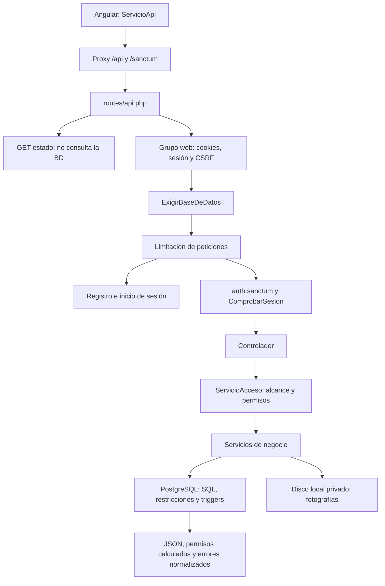

# Mapa del backend

Este documento describe el código Laravel de `backend/`, revisado el 17 de noviembre de 2026. El modo de prueba del navegador es independiente: sus datos no se envían a PostgreSQL y sus credenciales públicas no crean una cuenta en Laravel.

## Puntos de entrada

| Archivo o directorio | Responsabilidad | Cuándo consultarlo |
| --- | --- | --- |
| `backend/public/index.php` | Entrada HTTP de Laravel | Despliegue y servidor web |
| `backend/bootstrap/app.php` | Rutas, prioridad de middleware, respuestas JSON y traducción de errores SQL | Errores 409/422/503 y orden de autenticación |
| `backend/routes/api.php` | Contrato de rutas `/api` y límites de peticiones | Añadir o localizar una operación |
| `backend/routes/web.php` | Redirige `/` a `/api/estado` | Arranque manual |
| `backend/routes/console.php` | Comandos de consola | Operaciones administrativas |
| `backend/app/Http/Controllers/` | Validación HTTP, llamada a servicios y respuesta | Encontrar la implementación de una ruta |
| `backend/app/Services/` | Reglas del dominio, autorización, transacciones y cálculo de dosis | Cambiar comportamiento |
| `backend/app/Models/` | Mapeo Eloquent al SQL en castellano | Relaciones, asignación masiva y serialización |
| `backend/app/Policies/MascotaPolicy.php` | Política de lectura/escritura de mascotas | Reutilización de autorización Eloquent |
| `backend/config/` | Configuración; valores privados proceden de `.env` | Conexión, sesiones, CORS y archivos |
| `database/sql/` | Fuente de verdad del esquema | Cambiar tablas o restricciones |

## Recorrido de una petición



Las escrituras sobre una mascota pasan por `ServicioAcceso::modificar`: abre transacción, bloquea la mascota, comprueba el rol y bloquea/revalida el usuario. El orden mascota → usuario se comparte con operaciones sensibles de cuenta. Se permiten hasta tres intentos de la transacción. La autorización efectiva de los controladores está en este servicio; cambiar únicamente `MascotaPolicy` no cambia todas las rutas.

## Controladores y servicios

| Controlador | Operaciones | Colaboradores principales |
| --- | --- | --- |
| `ControladorSesion` | Registro, inicio/cierre, perfil, contraseña y eliminación de cuenta | `Usuario`, Auth, Hash, transacciones |
| `ControladorMascotas` | Listado/ficha/alta/edición, salir o eliminar, fotografía privada, auditoría paginada | `ValidarMascota`, `ServicioAcceso`, `ServicioPropiedad`, `ConfirmarContrasena` |
| `ControladorColaboraciones` | Consultar/aceptar códigos, generar/cancelar invitaciones, listar/revocar ayudantes | `ServicioAcceso`, `ServicioCodigos`, `ConfirmarContrasena` |
| `ControladorHistorial` | Consultas, vacunas, desparasitaciones, alergias y siguientes administraciones | `ServicioHistorial`, `ServicioAcceso` |
| `ControladorTratamientos` | Pautas versionadas, finalización/cancelación, dosis calculadas, resoluciones y correcciones | `ServicioTratamientos`, `GeneradorDosis`, `ServicioAcceso` |
| `ControladorAgenda` | Crear/editar/eliminar/resolver citas y tareas | `ServicioAcceso`, Carbon, Query Builder |
| `ControladorCalendario` | Unificar citas, tareas, previsiones sanitarias y dosis por intervalo | `ServicioTratamientos`, `ServicioAcceso` |

| Servicio | Regla que centraliza |
| --- | --- |
| `ServicioAcceso` | Mascotas accesibles, roles `propietario`/`ayudante`, transacciones de escritura, auditoría |
| `ServicioPropiedad` | Salida de copropietarios, reasignación del propietario de anclaje y eliminación definitiva al salir el último |
| `ServicioCodigos` | Aleatoriedad, normalización y SHA-256 de invitaciones de 16 caracteres; formato visible de cuatro grupos |
| `ConfirmarContrasena` | Confirmación de la contraseña actual para acciones sensibles |
| `ValidarMascota` | Especie habilitada, nacimiento parcial y real, zona horaria, datos descriptivos |
| `ServicioHistorial` | Mapeo de cuatro tipos sanitarios, validaciones temporales y listado unificado con autor |
| `ServicioTratamientos` | Validación de pautas, serialización JSON, versiones, ventana de hasta 93 días y unión con dosis resueltas |
| `GeneradorDosis` | Cálculo puro de ocurrencias: intervalos transcurridos o horarios locales; claves estables por versión e instante |

`GeneradorDosis` no inserta una fila por cada dosis prevista. Las ocurrencias se calculan a petición y sólo las resoluciones se almacenan. Los intervalos `cada_horas` se calculan desde `ancla_en`; las rutinas diarias/semanales usan la zona de la versión. Una hora local inexistente durante el cambio de primavera se omite. Deben probarse por separado cambios de horario, vigencia de versiones y cierres.

## Modelos y persistencia

`ModeloBase` adapta `creado_en`, `actualizado_en` y `eliminado_en`, y bloquea asignación masiva por defecto. `Usuario` hereda de `Authenticatable`, usa `correo`/`contrasena`, aplica el cast `hashed` y oculta contraseña, token de recuerdo, hash de recuperación y versión de sesión. `Mascota` define campos editables, oculta `foto_ruta`, relaciona especie y colaboradores y filtra por acceso.

Los otros modelos corresponden a las tablas del [diccionario SQL](BASE_DE_DATOS.md). Varios son mapeos mínimos; las operaciones de historial, agenda y tratamientos usan `DB::table` directamente. No debe inferirse que una operación falta por ver un modelo sin métodos. Tampoco un modelo reservado implica una función pública: `TransferenciaPropiedad` no tiene rutas activas y `tokens_recuperacion` no tiene flujo implementado.

## Autenticación y permisos

- API real: cookies de sesión, Sanctum SPA y CSRF. Solicitar `/sanctum/csrf-cookie` antes de escribir y enviar `X-XSRF-TOKEN`; el proxy de desarrollo conserva el mismo origen.
- `ExigirBaseDeDatos` responde 503 `BD_NO_CONFIGURADA` cuando `PETCARE_BD_HABILITADA=false`. `/api/estado` queda fuera y no abre conexión.
- `ComprobarSesion` rechaza cuentas eliminadas o `version_sesion` distinta de la almacenada en sesión. Cambiar contraseña incrementa la versión y regenera la sesión actual.
- El propietario puede escribir y compartir. El ayudante sólo consulta y puede abandonar su acceso. Los copropietarios tienen los mismos permisos; no se pueden revocar entre ellos.
- Una mascota inaccesible responde 404. Una operación de escritura no permitida sobre una mascota accesible responde 403.
- Los códigos caducan a los 20 minutos, son de un uso y el servidor conserva sólo su hash. Aceptarlos vuelve a validar el código bajo bloqueo. Se admiten como máximo diez códigos vigentes por mascota.

`mascotas.propietario_id` es un anclaje obligatorio, no un nivel superior de permiso. Si ese propietario sale, otro ocupa el anclaje. Al salir el último propietario se borran físicamente mascota, dependencias y foto. Las tablas conservan algunas columnas de borrado lógico por historia del esquema, pero no existe ruta de papelera/restauración.

## Configuración que afecta al desarrollo

| Archivo | Valores relevantes |
| --- | --- |
| `.env.example` | Plantilla sin credenciales: PostgreSQL, `PETCARE_BD_HABILITADA=false`, sesiones/cola/caché y URL de frontend |
| `config/petcare.php` | Activación explícita de persistencia y zona inicial `Europe/Madrid` |
| `config/database.php` | Conexión `pgsql`; exige extensión PHP `pdo_pgsql` |
| `config/auth.php` | Guard `web` y proveedor Eloquent `Usuario`; configuración de recuperación heredada sin rutas activas |
| `config/session.php` | En `.env.example`: archivos, 120 minutos, cifrado, `SameSite=lax`; cookie segura desactivada para HTTP local |
| `config/cors.php` | Origen único desde `FRONTEND_URL`, credenciales y cabeceras de CSRF |
| `config/filesystems.php` | Disco `local` privado; la fotografía se sirve pasando autorización |
| `bootstrap/app.php` | SQLSTATE 23505 → 409; 23503/23514/22008/22007 → 422; problemas de conexión/controlador reconocidos → 503 |

No registrar contraseñas, códigos originales ni contenido de `.env` en documentación. No crear tablas con migraciones: seguir el procedimiento SQL manual del [diccionario](BASE_DE_DATOS.md).

## Pruebas y límites conocidos

```powershell
cd backend
php artisan test
php artisan route:list --path=api
```

| Prueba | Cobertura |
| --- | --- |
| `tests/Feature/ArranqueSinBaseDeDatosTest.php` | Estado sin conexión SQL, bloqueo 503, autenticación y ausencia de rutas heredadas |
| `tests/Unit/PermisosYCodigosTest.php` | Roles, generación/normalización/hash de códigos, confirmación de contraseña |
| `tests/Unit/PoliticaMascotaTest.php` | Política de propietario, copropietario y ayudante |
| `tests/Feature/PropiedadCompartidaPostgresTest.php` | Integración opcional: códigos, permisos, salida de propietarios, conservación o borrado de datos |

La integración PostgreSQL sólo se activa con `PETCARE_PRUEBAS_POSTGRES=true` y una base dedicada cuyo nombre termina en `_pruebas`; `phpunit.xml` usa `gestion_mascotas_pruebas`. Cada prueba crea un esquema único dentro de una transacción y lo revierte. No habilitarla contra la base de uso normal. El esquema SQL no se ha ejecutado para redactar esta documentación; el éxito del modo navegador no valida persistencia, restricciones ni carreras concurrentes reales de PostgreSQL.

Pendientes de validación específica: concurrencia con varias conexiones, cambios de horario de dosis, recuperación frente a fallos entre BD y archivos, y despliegue HTTPS. La API no implementa recuperación/verificación de correo, notificaciones enviadas, transferencias exclusivas, papelera ni restauración. La auditoría procede de llamadas explícitas de servicios/controladores: no es un trigger universal y no registra automáticamente todas las acciones de cuenta/fotografía.
